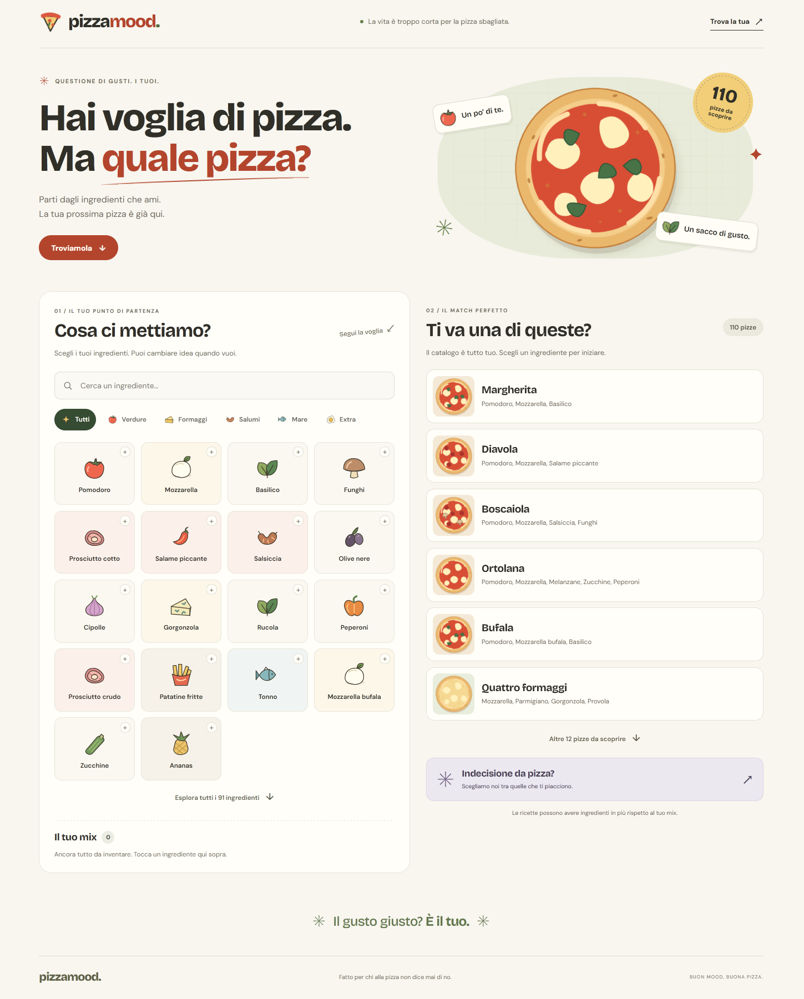

# Pizza Mood

Scegli gli ingredienti che ami e scopri quali pizze li contengono tutti.
Il catalogo comprende 112 ricette e 91 ingredienti, tutti associati ad almeno una pizza.
Pagina statica in italiano, con Vue 3.5.44 via CDN e Tailwind CSS 4.3.3
compilato in un file locale. Non occorre compilare JavaScript.

[Demo](https://archistico.github.io/pizza/)

## Avvio

Con Node.js 24 o successivo:

```sh
npm start
```

Aprire **http://127.0.0.1:8123**. I moduli JavaScript richiedono un server HTTP;
non aprire direttamente `index.html` con `file://`.
Il server locale non richiede dipendenze e ascolta soltanto su loopback.
Per scegliere un'altra porta impostare la variabile d'ambiente `PORT`.

Su un hosting statico basta caricare `index.html`, `js/`, `css/stile.css`
e `assets/`, conservando le cartelle. Non servono Node o npm sul server.

## Sviluppo e verifiche

```sh
npm install
npm run build:css
npm test
npm run test:browser
```

Modificare `css/input.css` e rigenerare `css/stile.css` dopo modifiche a stile,
template o classi Tailwind. Il CSS generato è incluso nel repository.
I test browser cercano Chrome/Edge installati su Windows o Chromium/Chrome
su Linux/macOS. È possibile indicare il percorso con `CHROME_PATH`.
Non vengono scaricati browser. Le schermate e l'esito vengono salvati in `out/`.

## File e comportamento

- `js/catalog.js`: tutte le 65 ricette originali e le etichette originali.
- `js/verified-recipes.js`: 35 nuove ricette, con ingredienti, menu di almeno
  due operatori per voce e note sulle varianti.
- `js/top-pizza-recipes.js`: 10 aggiunte dalla ricerca sui siti ufficiali dei
  locali di 50 Top Pizza Italia 2025, ciascuna con un secondo operatore.
- `js/ingredient-recipes.js`: Tre P con piselli e Pomodori secchi, entrambe
  documentate nei menu ufficiali di due locali indipendenti.
- `js/data.js`: identificativi, alias Cipolla/Cipolle, categorie e icone.
- `js/filters.js`: ricerca, compatibilità e selezione reversibile.
- `js/app.js`: stato Vue, template delle illustrazioni e suggerimento casuale.
- `js/vue-loader.js`: caricamento Vue da CDN con copia locale di riserva.
- `assets/ingredients.svg`: icone vettoriali originali, condivise tra gli ingredienti.

All'apertura vengono mostrate sei pizze del catalogo, con un pulsante per
mostrarne altre. Il contatore indica sempre il totale delle corrispondenze.
Le prime 18 proposte di ingredienti sono una selezione editoriale, non
statistiche d'uso. Tutti i 91 ingredienti sono accessibili con ricerca,
categorie o espansione. Senza selezioni tutti gli ingredienti sono attivi.
Dopo ogni scelta restano attivi solo quelli presenti in almeno una pizza
che contiene tutto il mix; gli altri rimangono visibili ma disabilitati.
Gli ingredienti scelti si possono sempre togliere, riattivando quelli tornati
compatibili. “Svuota tutto” ripristina l'intero catalogo. Il calcolo usa tutte
le pizze compatibili, comprese quelle non ancora mostrate nella lista.
Le due Regina conservano nome e ricette
originali ma hanno ID distinti. Le illustrazioni delle pizze sono stilizzate.

Le fonti e gli ingredienti delle 35 aggiunte sono elencati in
[RICETTE-VERIFICATE.md](docs/RICETTE-VERIFICATE.md), rigenerabile con
`npm run docs:recipes`. La prima fonte di ogni voce definisce la ricetta
adottata; la seconda conferma il nome presso un altro locale. Le varianti
sono documentate. Le 65 ricette iniziali restano separate dal lotto verificato.

Le 10 aggiunte dai locali classificati sono descritte in
[RICETTE-50-TOP-PIZZA.md](docs/RICETTE-50-TOP-PIZZA.md), con fonti ufficiali,
posizioni nella classifica 2025, varianti e limiti della ricerca. I menu
consultati sono quelli disponibili al 20 ottobre 2026. Il comando
`npm run docs:recipes` rigenera entrambi i resoconti; il primo mantiene i
totali storici del lotto precedente (da 65 a 100).

La successiva integrazione di piselli e pomodori secchi è descritta in
[RICETTE-INGREDIENTI.md](docs/RICETTE-INGREDIENTI.md), con ingredienti,
fonti ufficiali e differenze tra le versioni. La Tre P contiene pomodoro,
mozzarella, panna, prosciutto cotto e piselli; la Pomodori secchi contiene
pomodoro, mozzarella, pomodori secchi e rucola. Questa integrazione porta
il totale da 110 a 112 ricette senza aggiungere nuovi ingredienti.

## Direzione visiva e risorse

Fondo crema, rosso pomodoro, verde oliva, accento lavanda, forme morbide,
tipografia espressiva e icone a colori. Riferimento per la direzione 2026:
[Adobe — Design trends for 2026](https://www.adobe.com/express/learn/blog/design-trends-2026).

Le illustrazioni SVG sono nel progetto e non richiedono servizi esterni.
Bricolage Grotesque e DM Sans sono distribuiti localmente tramite le release
Fontsource Variable 5.3.0, con licenze OFL incluse in `assets/fonts/`.
Vue è distribuito con licenza MIT, inclusa in `assets/vendor/`.
La copia locale di Vue viene usata se il CDN fallisce o non risponde entro
cinque secondi. Una volta disponibili i file del sito, non servono altre
risorse esterne per font e illustrazioni. Non è installato un service worker.

L'analisi iniziale, precedente al refactor, è in `docs/ANALISI-REFACTOR.md`.
La mappa in `graphify-out/` descrive la versione iniziale, come indicato nel report.
